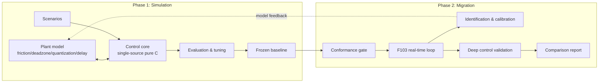

# dc-servo-lab

**Turn a ~¥30 geared encoder motor into a high-performance servo axis — simulation first, then deploy the very same C control core to STM32F103 + i.MX6ULL.**

This project focuses on one deep problem: *trustworthy migration of servo control algorithms from simulation to real hardware* — system identification, feedforward compensation, disturbance observation (DOB), and frequency-domain validation, wrapped in a rigorous MIL → SIL → PIL workflow borrowed from automotive V-process development.

## Why

Humanoid robot companies build their own joint actuators (motor + driver + encoder + bus). The core pain points at that layer — torque transparency, friction compensation, sim-to-real gaps — are exactly what this project exercises, on the cheapest possible hardware. Target roles: joint actuator / servo software engineer.

## Approach

- **Phase 1 — Simulation (MIL/SIL)**: build the plant model with explicit non-idealities (Coulomb/viscous friction, PWM deadzone, encoder quantization, control delay), develop the control laws in pure C against it, tune, and freeze a performance baseline.
- **Phase 2 — Migration (PIL/HIL)**: port the *same* control core to STM32F103 (real-time layer) with i.MX6ULL as the instrumentation/tuning host. A step-by-step conformance test (sim vs. target, same input sequence) is the acceptance gate before any closed-loop run on hardware.
- **Iteration loop**: measured identification data flows back into the plant model; retuned parameters flow back to the target.

Final deliverable: a measured three-controller comparison report (tracking RMS, disturbance recovery, sensitivity peak, low-speed creep), reproducible codebase, and demo videos.

## Architecture

Key contracts (see [docs/design_decisions.md](docs/design_decisions.md)):

- Control core: C99, fixed timestep (1 kHz velocity / 250 Hz position), POD interfaces, normalized duty output `u ∈ [-1, +1]`, no I/O, no dynamic memory.
- One authoritative parameter file (JSON, versioned) shared by simulation and firmware.
- Same scenario descriptions drive both simulation replay and on-target execution.
- Closed loop never depends on any communication link.

## Roadmap

| # | Step | Status |
|---|---|---|
| 1 | Interface-level contracts + repo skeleton | ✅ |
| 2 | Plant simulation model (non-idealities configurable) | ⬜ |
| 3 | Control laws: PI anti-windup → feedforward → DOB (pure C + tests) | ⬜ |
| 4 | Tuning, scenario tests, frozen simulation baseline | ⬜ |
| 5 | Target runtime layer (F103 firmware + 6ULL tooling) | ⬜ |
| 6 | Migration conformance gate (sim vs. target) | ⬜ |
| 7 | Basic real closed loop + timing measurements | ⬜ |
| 8 | On-target identification, model calibration loop | ⬜ |
| 9 | Feedforward/DOB on hardware, frequency-domain validation | ⬜ |
| 10 | Three-controller comparison, networked joint interface, report | ⬜ |

## Repository Layout

| Path | Purpose |
|---|---|
| `docs/` | Design decisions, architecture, per-task plans |
| `sim/` | Plant model & scenario excitation (Phase 1) |
| `common/ctrl/` | Control core: pure-C control laws (single source of truth) |
| `firmware/` | STM32F103 real-time layer (Phase 2) |
| `edge/` | i.MX6ULL tooling: logging, orchestration, tuning |
| `analysis/` | PC analysis: identification fitting, frequency domain, reports |
| `tests/` | Host-side unit tests |
| `tools/` | Scripts: log decoding, conformance comparison |
| `experiments/` | Experiment runners & metrics |

## Requirements

- Python 3.11+ with NumPy / SciPy / Matplotlib (Windows native, no GPU needed) — Phase 1
- Any host C99 compiler + CMake for control-core unit tests
- Hardware (~¥60–80, plug-and-play, no mechanical assembly): encoder gearmotor, BTS7960 driver, optional W5500 Ethernet module — Phase 2

## Documentation

- [docs/architecture.md](docs/architecture.md) — two-phase architecture, contracts, principles
- [docs/design_decisions.md](docs/design_decisions.md) — interface-level decision list (single source of truth for all three callers of the control core)
