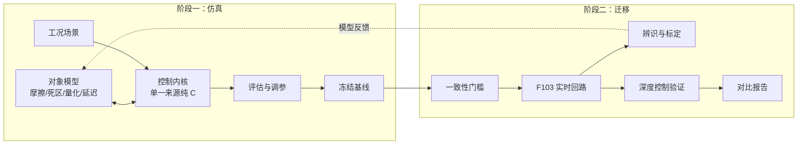

# dc-servo-lab

**把一枚约 ¥30 的带编码器减速电机改造成高性能伺服轴 —— 先仿真，再把同一套 C 控制内核部署到 STM32F103 + i.MX6ULL。**

本项目聚焦一个深水区问题：*伺服控制算法从仿真到真实硬件的可信迁移* —— 系统辨识、前馈补偿、扰动观测器（DOB）、频域验证，并套用汽车行业 V 流程开发中严格的 MIL → SIL → PIL 工作流。

## 为什么做这个

人形机器人公司都在自研关节执行器（电机 + 驱动器 + 编码器 + 总线）。这一层的核心痛点 —— 力矩透明性、摩擦补偿、sim-to-real 差距 —— 正是本项目要在最便宜的硬件上练手的内容。目标岗位：关节执行器 / 伺服软件工程师。

## 技术路线

- **阶段一 —— 仿真（MIL/SIL）**：搭建含显式非理想环节的被控对象模型（库仑/粘性摩擦、PWM 死区、编码器量化、控制延迟），用纯 C 面向该模型开发控制律，调参并冻结性能基线。
- **阶段二 —— 迁移（PIL/HIL）**：把*同一套*控制内核移植到 STM32F103（实时层），以 i.MX6ULL 作为仪器化/调参主机。任何硬件闭环之前，先通过逐步一致性测试（仿真 vs. 目标机，相同输入序列）作为验收门槛。
- **迭代闭环**：实测辨识数据回流到对象模型；重新整定的参数回流到目标机。

最终交付物：一份基于实测的三种控制器对比报告（跟踪 RMS、扰动恢复、灵敏度峰值、低速爬行）、可复现的代码库，以及演示视频。

## 架构

关键约定（见 [docs/common/design_decisions.md](docs/common/design_decisions.md)）：

- 控制内核：C99，固定步长（速度环 1 kHz / 位置环 250 Hz），POD 接口，归一化占空比输出 `u ∈ [-1, +1]`，无 I/O，无动态内存。
- 唯一权威参数文件（JSON，纳入版本管理），仿真与固件共用。
- 同一份工况场景描述，既驱动仿真回放，也驱动目标机执行。
- 闭环绝不依赖任何通信链路。

## 路线图

| # | 步骤 | 状态 |
|---|---|---|
| 1 | 接口层约定 + 仓库骨架 | ✅ |
| 2 | 对象仿真模型（非理想环节可配置） | ⬜ |
| 3 | 控制律：PI 抗饱和 → 前馈 → DOB（纯 C + 测试） | ⬜ |
| 4 | 调参、工况测试、冻结仿真基线 | ⬜ |
| 5 | 目标机运行时层（F103 固件 + 6ULL 工具链） | ⬜ |
| 6 | 迁移一致性门槛（仿真 vs. 目标机） | ⬜ |
| 7 | 基础真机闭环 + 时序测量 | ⬜ |
| 8 | 目标机辨识、模型标定闭环 | ⬜ |
| 9 | 硬件上前馈/DOB、频域验证 | ⬜ |
| 10 | 三种控制器对比、联网关节接口、报告 | ⬜ |

## 仓库结构

| 路径 | 用途 |
|---|---|
| `docs/common/` | 跨阶段文档：设计决策、架构 |
| `docs/sim/` | 阶段一文档：任务规划（plan_step*.md）、仿真实验报告 |
| `docs/hardware/` | 阶段二文档：固件设计、标定与实测报告 |
| `sims/plant/` | 被控对象模型（Python） |
| `sims/host/` | 仿真宿主 |
| `sims/tests/` | 仿真侧单元测试（pytest） |
| `sims/params/` | 参数与场景 JSON（D5/D6 落地位） |
| `firmware/` | 嵌入式代码：STM32F103 实时层 + i.MX6ULL 工具（阶段二） |

## 环境要求

- Python 3.11+，含 NumPy / SciPy / Matplotlib（Windows 原生，无需 GPU）—— 阶段一
- 任意宿主机 C99 编译器 + CMake，用于控制内核单元测试
- 硬件（约 ¥60–80，即插即用，无需机械装配）：带编码器减速电机、BTS7960 驱动器、可选 W5500 以太网模块 —— 阶段二

## 文档

- [docs/common/architecture.md](docs/common/architecture.md) —— 两阶段架构、约定、原则
- [docs/common/design_decisions.md](docs/common/design_decisions.md) —— 接口层决策清单（控制内核三个调用方的唯一事实来源）
- [docs/sim/plan_step2.md](docs/sim/plan_step2.md) —— 步骤②子任务管理（子 README：状态表、决策登记、续接指引）
- [CODEBUDDY.md](CODEBUDDY.md) —— 项目规范入口：目录结构约束、编码标准与决策记录机制（详细规则在 `.codebuddy/rules/`）
