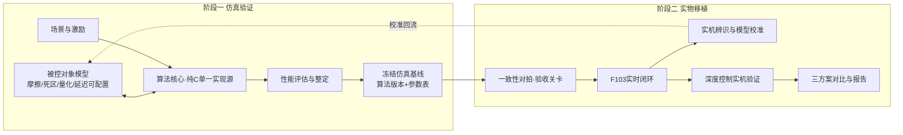

# 系统架构

## 1. 定位

将一台约 30 元的带编码器直流减速电机打造成高性能伺服轴。不做整车、不做机械装配，聚焦单一复杂问题：**伺服控制算法从仿真到实机的可信迁移**。最终产出带实测数据的三方案对比研究报告（PI / PI+前馈 / PI+前馈+DOB）、可复现代码库与演示视频，对标机器人关节驱动与伺服软件岗位。

## 2. 两阶段划分

| | 阶段一：仿真验证 | 阶段二：实物移植 |
|---|---|---|
| 定位 | 回答"算法对不对、参数好不好" | 回答"性能保住了多少" |
| 目标 | 算法正确性、参数整定、模型建设 | 数值一致性、实时性达标、真实非理想性下性能保持、安全鲁棒 |
| 退出判据 | 全场景达标，冻结算法版本 + 参数表 | 三方案对比完成，实机-仿真差距分析闭环 |

## 3. 分层与数据流



分层职责：

- **仿真环境（PC 侧宿主）**：被控对象模型 + 场景激励生成 + 仿真联调宿主；只调用算法核心，不实现控制律。
- **算法核心（单一实现源）**：无硬件依赖的纯 C 控制律；仿真宿主、主机单测、固件任务三个调用方共用；不含 I/O 与时序逻辑。
- **目标平台运行层**：F103 实时层（固定周期调用算法核心、传感采集、安全监控、时序自测）+ i.MX6ULL 工具层（记录、编排、调参，不参与控制回路）。
- **通信与调试（横切层）**：接口级约定先定，具体协议在各子任务详细规划时确定。

## 4. 阶段间衔接：四类契约

1. **算法接口契约**：标准化输入输出 + 固定步长。
2. **参数契约**：统一参数表 + 版本号，仿真整定输出与实机加载同一文件。
3. **场景契约**：同一激励序列驱动仿真回放与实机下发。
4. **数据契约**：记录格式双端一致，分析管线无需区分数据来源。

移植验收关卡为**一致性对拍**：相同输入序列逐拍比对目标机与仿真输出，容差内方可上实机。

## 5. 贯穿原则

- 算法核心任何修改必须同时通过仿真、单测、实机三关，防实现分叉。
- 仿真显式包含非理想性与参数摄动，基线须在最坏摄动下成立，防仿真过拟合。
- 闭环本地自治，通信链路不进入控制环。
- 运算量预算制（F103 无 FPU）；数值一致性以容差对齐为判据；延迟实测回填模型。
- 风险对策：模型失配 → 辨识数据校准回流（迭代而非瀑布）；一致性偏差超容差 → 对拍关卡拦截；实时性超预算 → 结构简化。

## 6. 顶层目录骨架（子目录在各子任务规划时细化）

```
robot/
├── README.md            # 英文项目主页
├── docs/                # 设计决策、架构、各子任务规划文档
├── sim/                 # 被控对象模型与场景激励（阶段一）
├── common/ctrl/         # 算法核心：纯 C 控制律（单一实现源）
├── firmware/            # STM32F103 实时层（阶段二）
├── edge/                # i.MX6ULL 工具层（阶段二）
├── analysis/            # PC 分析层：辨识拟合、频域、报告
├── tests/               # 主机端单元测试
├── tools/               # 脚本工具（解码、对拍等）
└── experiments/         # 实验运行器与指标统计
```

接口级契约的完整决策清单见 `docs/design_decisions.md`。
